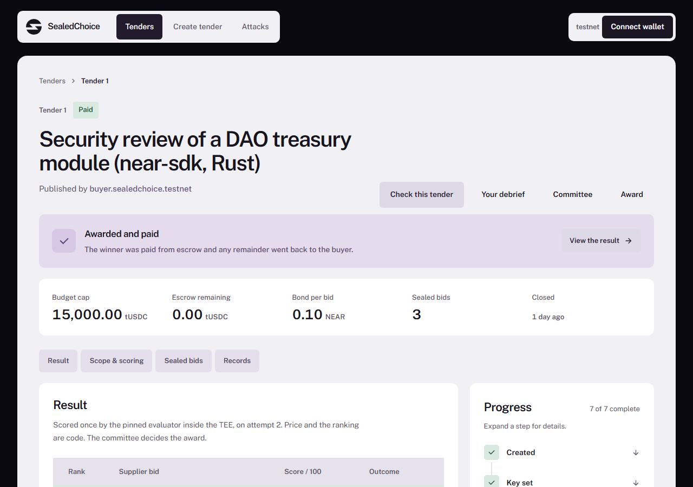
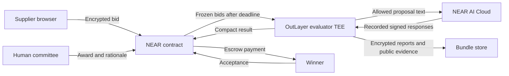

# SealedChoice

**Sealed tenders, verifiable awards.** SealedChoice helps a buyer choose a supplier on NEAR: suppliers encrypt bids in their browsers to an OutLayer TEE key; after the deadline, a pinned evaluator scores them against a rubric published before bidding; a human committee awards; escrow pays the winner. It targets small DAOs and ecosystem teams hiring digital service providers. Procurement otherwise asks suppliers to trust whoever holds their bids, scores them and arranges payment.

[Open the app](https://sealedchoice.com/tenders) | [Documentation](https://docs.sealedchoice.com) | [Recorded attacks](https://sealedchoice.com/attacks)

The prototype uses **NEAR testnet and tUSDC**, with three completed static demo tenders. Cross-chain payout is deferred. Contract-account and secret-owner keys **remain retained**. Public source and frozen source tags are not yet published. See [limits](#limitations-and-next-steps).

## Try it in two minutes

No wallet or installation is required.

1. Open [tender 1](https://sealedchoice.com/tenders/1). See the published rubric, three sealed bids and completed lifecycle. The result ranks **A 86.66 / C 52.00 / B 47.55**. C is flagged for injection and remains eligible.
2. Open [Verify](https://sealedchoice.com/tenders/1/verify). The recorded release passes **10/10 public checks**, with zero failures and zero skips. Inspect each row's evidence links. A transport outage can prevent a live check from finishing.
3. Open [the paid award](https://sealedchoice.com/tenders/1/award). See **12,000 tUSDC** paid to `vendor-a.sealedchoice.testnet`, with the committee decision separate from payment state.
4. Compare [tender 2's award](https://sealedchoice.com/tenders/2/award). The committee selected lower-ranked B for **9,000 tUSDC**, with its reason recorded on-chain.
5. Open [Attacks](https://sealedchoice.com/attacks). See ten recorded attempts on tender 3: nine refusals and one detected injection. Expand the records for transactions and exact outcomes.



The completed tenders cannot accept new bids. Private debrief and committee reports require the registered reader's wallet message signature. Follow the [buyer](apps/docs/docs/guides/buyers.md), [bidder](apps/docs/docs/guides/bidders.md) and [committee](apps/docs/docs/guides/committee.md) guides for a new tender.

## Run it locally

Use the supplied source checkout. Prerequisites: Node.js **22.12+** (checked on **24.19.0**), pnpm **12.16.1**, and internet access for public chain evidence. No environment file, wallet or secret is needed for the read-only demo.

```bash
pnpm install --frozen-lockfile
pnpm -r test
pnpm -r lint
pnpm -r typecheck
pnpm verify --tender 1 --network testnet --contract tenders-v1.sealedchoice.testnet
```

Expected live result: **10/10 checks passed**, no failures or skips. `--json` exposes `passed`, `failed` and `skipped`. The CLI exits non-zero for a failure or a loading error; a skip alone does not make its exit code non-zero, so inspect all three counts. Do not use `--no-artifact` for complete verification.

```bash
pnpm --filter web dev
```

Open [localhost:3000/tenders](http://localhost:3000/tenders). In another terminal, `pnpm --filter docs dev` starts the docs at [localhost:3001](http://localhost:3001). Production builds are `pnpm --filter web build` and `pnpm --filter docs build`. More setup and Rust checks: [developer guide](apps/docs/docs/developers.md).

## How it works



The rubric, evaluator reference, committee, deadline and bond are fixed at creation. Closing freezes the bid set. The evaluator validates that set and produces evidence; the contract accepts only one result. Failed attempts are recorded and capped at three. Tender 1's first attempt failed during model availability; its second was accepted. See the [architecture](apps/docs/docs/technical/architecture.md).

| Decision | Responsible party | Verification boundary |
| --- | --- | --- |
| Eligibility, price, quote checks, aggregation, totals and ranking | Code | Integer rules, executable reference and shared vectors |
| Text criterion judgments | Two models in the demo; rubrics support two or three | Signed response hashes, quote checks and lower median; new inference may differ |
| Award | Human committee | Eligible bid, approval threshold and recorded deviation rationale |
| Payment | NEAR contract after winner acceptance | Escrow accounting and transfer result |

AI receives only allowed text fields, not the structured price. It never computes the ranking or makes the award. A supplier can still disclose a price in its prose. Details: [scoring](apps/docs/docs/technical/scoring.md), [scoring implementation](evaluator/core/src/lib.rs), [request construction](evaluator/wasm/src/prompt.rs).

## NEAR technologies used

| Technology | Concrete use | Source |
| --- | --- | --- |
| NEAR Rust contract | Lifecycle, deadline guards, callbacks, bonds, escrow, awards and payouts | [Contract](contracts/tender/src/lib.rs) |
| OutLayer | Pinned WASM execution and secret release inside a TEE | [Live services](evaluator/wasm/src/live.rs), [pipeline](evaluator/wasm/src/pipeline.rs) |
| NEAR AI Cloud | Private text inference with signed request/response hashes | [Live services](evaluator/wasm/src/live.rs), [signature checks](packages/verify/src/checks.ts) |
| NEP-141 / NEP-145 | Test-token escrow transfers and token storage registration | [Contract API](contracts/tender/README.md), [testnet runner](scripts/e2e-testnet.ts) |
| NEP-297 | Contract event logs | [Events](contracts/tender/src/events.rs) |
| NEP-413 | Wallet-message-derived private reader keys | [Reader flow](apps/web/src/lib/wallet/reader-key.ts), [crypto](packages/crypto/src/index.ts) |
| Named accounts | Buyer, bidder and contract identities on testnet | [Deployment configuration](apps/web/src/config/evidence.ts) |

NEAR Intents 1Click is an optional deferred integration. The recorded release demonstrates NEAR testnet token payments, not a live cross-chain transfer. Function-call-key and DAO integrations are not presented as demonstrated user flows.

## What the evidence establishes

The public verifier checks rubric commitments, creation time, the frozen set, evaluator artifact hash, one accepted result, bundle integrity, model coverage, signatures, attestation fields and ranking consistency. [Implementation](packages/verify/src/checks.ts), [negative tests](packages/verify/src/checks.test.ts), [check boundaries](apps/docs/docs/technical/verification.md).

Public checks do not expose private proposal text or independently recompute its qualitative scores. Authorized readers can verify those from encrypted reports. The browser first compares raw bundle bytes with the accepted on-chain commitment. [Bundle boundary](packages/verify/src/bundle-commitment.ts), [replacement regressions](packages/verify/src/report-open.test.ts).

Signature recovery and recorded attestation fields do not constitute complete Intel TDX/GPU certificate-chain verification. Artifact hashing does not prove source reproducibility. The bundle store can withhold evidence. See [security and limits](apps/docs/docs/security.md).

## Evidence from the final demo

Contract: [`tenders-v1.sealedchoice.testnet`](https://testnet.nearblocks.io/address/tenders-v1.sealedchoice.testnet). Test token: `usdc.sealedchoice.testnet`, six decimals.

| Tender | Recorded outcome | Evidence |
| --- | --- | --- |
| 1 | Top-ranked A paid 12,000 tUSDC; 3,000 returned to buyer | [Evaluation 15517](https://outlayer.ai/requests/15517), [award](https://testnet.nearblocks.io/txns/F6GLGTEr578fMvXyaCVp6HXxTFncAWiETisudZC1cxMN), [payment](https://testnet.nearblocks.io/txns/8ZMMLktGoLx3zAiR3GSCYazdMutHYbFvueWc2zEqwPnG) |
| 2 | Lower-ranked B paid 9,000 tUSDC with rationale; 6,000 returned to buyer | [Evaluation 15566](https://outlayer.ai/requests/15566), [award](https://testnet.nearblocks.io/txns/4LkAknhPVghNU4ySXwKPGHKNWeK2WMa4ssn42retuGXX), [payment](https://testnet.nearblocks.io/txns/7EVG9uV34qn7WGwjY4rXyzvTMDgUvzT66TiLZL78CmFG) |
| 3 | Dedicated attack tender, completed and Paid | [Attack records](apps/web/src/data/attacks.json), [verifier](https://sealedchoice.com/tenders/3/verify) |

Tender 1's [bundle](https://sealedchoice-lab.vercel.app/api/bundles/b51e5e927d344ac456054e979fd4e82bb132571e0b91665b39e2aeec54d518a7) is **817,201 bytes**; its compact result is **309 bytes**, with **six** signed model calls. See [all lifecycle transactions](apps/docs/docs/evidence.md) for creation, funding, each bid, close, retry, award and payment.

Frozen contract SHA-256: `21e94da15087a942debeaa547bf5e5caaec4a4dc0a669e07e7af0e78b762b307`.

Frozen evaluator SHA-256: `737b91e724b25facefce9d9e53655bd18e3a4070c857af54f88f0e7b5f18d470`, available at the [immutable artifact URL](https://raw.githubusercontent.com/farouk-allani/sealedchoice-artifacts/392c47bc342dc818d0676f32d71ff63239ab1e0d/evaluator/evaluator-v1.0.0-737b91e7.wasm).

Frozen source tags remain local pending publication. Clean release builds were compared; public cold-source reproduction remains pending that publication. The [developer guide](apps/docs/docs/developers.md#builds-and-frozen-artifacts) distinguishes ordinary host builds from the frozen release context.

### Measured attack outcomes

Generated from the same dataset as `/attacks` with `pnpm attacks:table`:

<!-- attack-table:start -->
| Attempt | Recorded outcome | Testnet evidence |
| --- | --- | --- |
| 1. Read bids through a direct request | Access denied | [Transaction](https://testnet.nearblocks.io/txns/HSuJU5SMZQiedf3FB1NMCWDtFpLs5YMoQpuSwmAuuVGn), [OutLayer 15559](https://outlayer.ai/requests/15559) |
| 3. Change the published rubric | MethodNotFound | [Transaction](https://testnet.nearblocks.io/txns/95r9z2AuNW33Q7iVDvxbHnzy2PGcUt35mvz84jCtsN25) |
| 4. Close before the deadline | E_DEADLINE_NOT_REACHED | [Transaction](https://testnet.nearblocks.io/txns/9S3aYuJUW76mk913wy5wXo8XhFmzVxPfDxUnZN6LB58B) |
| 5. Copy a sealed bid | E_DUPLICATE_CIPHERTEXT | [Transaction](https://testnet.nearblocks.io/txns/9xR5rfo8Ua7x8cjhAG72zBNMAwrFxXGA6sDaVgacAMEL) |
| 6. Deliver a fake evaluation | Private callback | [Transaction](https://testnet.nearblocks.io/txns/J5pa7f8ykjMHmT2GPz7wdZqDAFTXGPDcPvTfkMFDWFcF) |
| 7. Evaluate a second time | E_BAD_STATUS | [Transaction](https://testnet.nearblocks.io/txns/F5nAoEsWQHeNpsViRhkqaKjRE9w2ZZ6uLRa17gnpJPy8) |
| 8. Award as an outsider | E_NOT_COMMITTEE | [Transaction](https://testnet.nearblocks.io/txns/J4nRsu49sZqYQZJ95BeXPxjTuzGTi3ZweKSBLDgmANEE) |
| 9. Deviate without a rationale | E_RATIONALE_REQUIRED | [Transaction](https://testnet.nearblocks.io/txns/4N7pLkDmwhUHQXSjgNydi8x5fbippeoWB2axR6DaGcqh) |
| 10. Accept and redirect another bidder's award | E_NOT_WINNER | [Transaction](https://testnet.nearblocks.io/txns/3fBhz7ds8ebGNpKZ4xCW9uZroYJKyo9zzectH9mtDNXo) |
| 11. Inject instructions into a proposal | INJECTION_SUSPECTED | [Transaction](https://testnet.nearblocks.io/txns/E1uqsogvgd3wKYK3Hhtm4eBEzfMRRh4NinKTFYwbaW5N), [OutLayer 15568](https://outlayer.ai/requests/15568) |
<!-- attack-table:end -->

The injection experiment establishes a recorded detection. It does not establish universal model resistance. C remained eligible and ranked second in tender 1.

## Tests

Run `pnpm -r test` for TypeScript, `python specs/reference/reference.py --check` for reference vectors, and `cargo test --workspace` for Rust. Rust **1.97.0** is pinned by [rust-toolchain.toml](rust-toolchain.toml). The offline WASM harness is `cargo test -p evaluator-harness --features run`; contract sandbox checks use `scripts/sandbox/test.sh` on a compatible Linux host.

| Invariants | Tested constraints | Tests |
| --- | --- | --- |
| I1 | Immutable configuration and creation timestamp | [Contract tests](contracts/tender/src/tests.rs) |
| I2, I3 | Bid and evaluation deadline boundaries | [Contract tests](contracts/tender/src/tests.rs) |
| I4 | Frozen set and Merkle root | [Contract tests](contracts/tender/src/tests.rs), [crypto tests](packages/crypto/src) |
| I5, I6, I7 | One accepted result, private callback, echoed commitments | [Contract tests](contracts/tender/src/tests.rs) |
| I8 | Committee, eligible award and deviation rationale | [Contract source and tests](contracts/tender/src) |
| I9, I10, I11 | Single payment/bond settlement and exact escrow | [Contract tests](contracts/tender/src/tests.rs) |
| I12, I13 | Retry cap and ciphertext uniqueness | [Contract tests](contracts/tender/src/tests.rs) |
| I14, I15 | Rubric parity and real curve-point keys | [Contract tests](contracts/tender/src/tests.rs), [evaluator tests](evaluator/core/src) |
| Scoring and readers | Rust/TS/reference parity, signature failures and accepted-bundle commitment | [Shared vectors](specs/test-vectors), [verifier tests](packages/verify/src) |

The local WSL sandbox requires a newer glibc than this host provides (2.39 required, 2.35 installed), so no local sandbox success is claimed. GitHub Actions currently fails before jobs start; no successful current CI run is claimed.

## Prior art

Related work includes [Kemal Bicakci's TEE-based grant-evaluation architecture](https://arxiv.org/abs/2604.25200), [BlindProcure's encrypted lowest-offer selection](https://community.zama.org/t/blindprocure-onchain-procurement-without-price-leakage/4503), and [OutLayer's private DAO example](https://app.outlayer.ai/docs/examples). SealedChoice combines encrypted multi-criterion procurement, recorded model evidence, human awards and NEAR escrow payments. It does not claim to invent sealed bidding or attested inference, and these references are not an independent benchmark of other projects.

## Limitations and next steps

- **Retained keys:** the contract's full-access key can replace code or sign as the contract; the secret-row owner can rebind access. Neither account has been locked. The privacy model includes trust in those retained powers.
- **Models vary:** identical earlier rubric/proposal runs produced A at 81.66/86.66/86.66 and C at 52.00/52.00/45.00. Ranking order changed below A. Verification recomputes recorded outputs rather than rerunning inference. [Measurements](apps/docs/docs/evidence.md#model-variability).
- **Outcome privacy:** bidder identity, time, ciphertext length, rank, total, flags, award and payout are public. A bidder's price score may reveal the lowest eligible price. The committee sees every proposal.
- **Prototype scope:** five active bids per tender, two-model demo, one committee approver, test tokens, completed static tenders, no demonstrated cross-chain payment or production buyer adoption.
- **External trust:** TEE services, browser delivery, RPC and bundle availability remain dependencies. Collusion, false claims, a biased rubric and poor committee decisions remain possible.
- **Release work:** public source/tag publication, a complete hardware-attestation verifier, external security review and production payment validation remain separate work.

## License

The team has not selected a project license yet. Bundled third-party fonts and icons retain their own license files. The project license is a T16 release decision; no MIT grant is implied.
