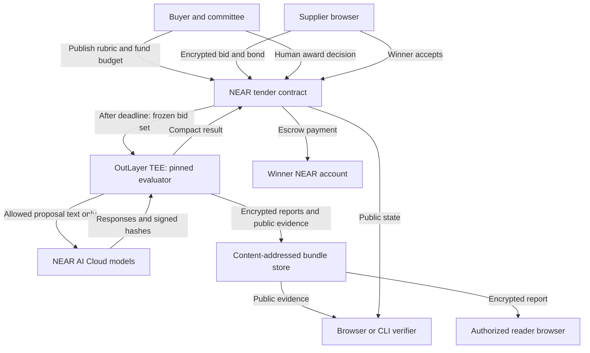

The contract records the process and moves escrow. The evaluator opens bids inside an OutLayer TEE. The browser encrypts submissions and opens authorized reports. The bundle store serves evidence addressed by its hash.

## The contract

`contracts/tender` implements the state machine, immutable tender configuration, deadline checks, frozen bid set, callback validation, committee approvals, bonds and escrow transfers. It accepts at most one evaluation result per tender. Failed execution attempts may be retried, up to three attempts total.

The current deployment is `tenders-v1.sealedchoice.testnet`. The earlier `tenders.sealedchoice.testnet` contract remains historical evidence and is not interchangeable with it. Tender IDs are local to a contract.

## The evaluator

`evaluator/wasm` runs the pinned WebAssembly binary in OutLayer. It derives the tender key from its secret, checks the input commitment, decrypts bids, invokes the pure scoring library in `evaluator/core`, requests text judgments and uploads the evidence bundle. Its compact result is capped at 900 bytes; tender 1's result was 309 bytes.

The tender pins an evaluator URL, SHA-256 and source reference. Hashing the artifact can establish its identity against that pin. Establishing that the source produces those bytes is a separate reproducible-build check.

## What the models receive

The evaluator constructs model requests from the rubric and the allowed qualitative fields, `methodology` and `track_record`. Structured price, eligibility, totals and ranking stay in code. Models return criterion scores, quotes, rationales and missing-evidence notes.

The final demo uses two models; rubrics support two or three. The [scoring guide](./scoring.md) explains quote validation and the lower median.

## What is public

| Record | Visibility |
| --- | --- |
| Rubric, deadline, committee, evaluator pin and tender public key | Public on-chain |
| Bidder account, timestamp, ciphertext, ciphertext length and hash | Public on-chain |
| Frozen set, accepted attempt, ranks, totals and flags | Public on-chain |
| Award, rationale, winner and payment | Public on-chain |
| Request/response hashes, signatures, attestation fields and encrypted envelopes | Public bundle |
| Bid text, losing bid prices, detailed scores and raw model conversations | Encrypted for the bidder and committee |

The awarded amount is public. A bidder's own price score can reveal the lowest eligible price through the price formula. The system does not conceal bidder participation or all outcome information.

## Reader access

`packages/crypto` implements canonicalization, hashes, Merkle operations, encryption and wallet-signature reader-key derivation. A bidder derives a key for its own debrief; a committee member derives a separate key for the committee report. Private reader keys remain in the browser.

Before decryption, `packages/verify` checks the exact downloaded bundle bytes against the accepted result's hash. Encryption authenticates an envelope under a key; the on-chain bundle commitment identifies the accepted envelope.

## Trust assumptions

The process depends on NEAR execution, OutLayer's TEE and secret-release rules, the pinned evaluator, NEAR AI's service and the delivered browser code. The store can withhold a bundle even though it cannot silently replace its accepted bytes. Retained contract and secret-owner keys create additional operator powers. See [security and limits](../security.md).
