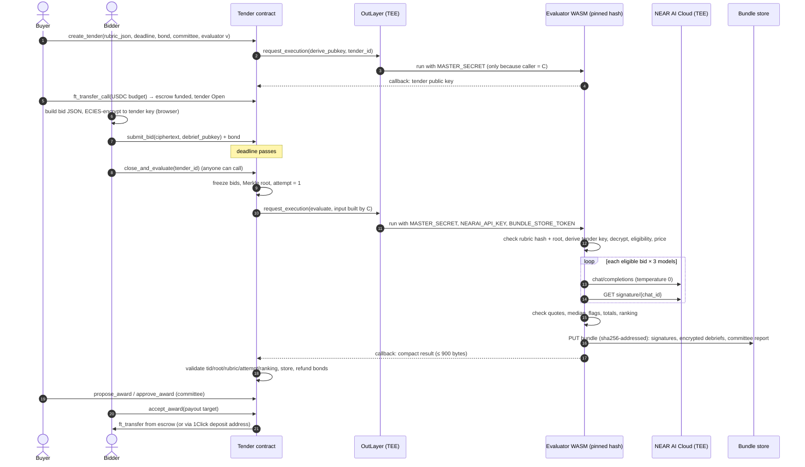

# 02 — Architecture

## Components

```
sealedchoice/
├── contracts/tender        Rust near-sdk contract: tenders, bids, close, evaluate, award, escrow, payout
├── contracts/mock-outlayer Rust test contract that imitates outlayer.testnet for sandbox tests
├── evaluator/core          Rust lib, pure scoring (no I/O). Compiled natively for tests and into the WASM
├── evaluator/wasm          Rust wasm32-wasip2 binary run by OutLayer: derive_pubkey | evaluate | quote | payout_status
├── packages/shared         TS: brand constant, types generated from specs/schemas, constants (flags, limits)
├── packages/crypto         TS: JCS, sha256, Merkle, ECIES (eciesjs), NEP-413 key derivation
├── packages/verify         TS: scoring core (port of reference.py), bundle/signature/attestation checks
├── apps/web                Next.js app: buyer, bidder, committee, public verify, attack demo; API route for the bundle store
├── scripts/                deploy, seed demo tender, run attacks, verify CLI
└── specs/                  rubric/bid/result/bundle schemas, prompt, reference implementation, test vectors
```

## Trust boundaries

| Box | Trusted for | Not trusted for |
|---|---|---|
| Tender contract | state machine, deadlines, immutability, escrow, award rules | nothing off-chain |
| OutLayer TEE + pinned evaluator WASM | holding keys, decrypting after close, honest execution of the published code | fairness of the rubric |
| NEAR AI Cloud TEEs | running the named model on the exact request, signing request/response hashes | quality of the model's judgment |
| Bundle store (our web app) | availability only; content is addressed by hash | integrity (anyone checks the hash) |
| Browser of a bidder | encrypting their own bid, keeping their debrief key | anything about other bids |
| Committee | the award decision | nothing technical; their deviations are recorded |
| SealedChoice operator (us) | running the web app | reading bids, choosing results, changing rubrics (we cannot) |

## Lifecycle and messages



## Contract state machine (summary; full spec in 03-contract.md)

```
PendingKey ──key callback──▶ AwaitingFunds ──escrow funded──▶ Open
Open ──cancel_tender (buyer, before deadline)──▶ Cancelled
Open ──close_and_evaluate after deadline, 0 bids──▶ NoBids
Open ──close_and_evaluate after deadline──▶ Evaluating(attempt=1)
Evaluating(n) ──valid result──▶ Evaluated
Evaluating(n) ──failure──▶ EvalFailed(n) ──retry_evaluate, n<3──▶ Evaluating(n+1)
EvalFailed(3) ──▶ Failed (everything refunded)
Evaluated ──award approved──▶ Awarded ──accept_award──▶ PayingOut ──▶ Paid
Awarded ──acceptance window lapses──▶ Evaluated (that bid marked lapsed)
Evaluated ──close_without_award (committee, rationale)──▶ ClosedNoAward
```

## Data placement

| Data | Where | Visibility |
|---|---|---|
| Rubric JSON + hash | contract state | public |
| Tender public key | contract state | public |
| Bid ciphertext, debrief pubkey, leaf | contract state | public (ciphertext only) |
| Bid plaintext | only inside the TEE run, and inside encrypted debrief/report | bidder, committee after close |
| Compact result (ranking, totals, flags, hashes) | contract state | public |
| Evidence bundle (signatures, hashes, attestation, encrypted envelopes) | bundle store, addressed by sha256 | public |
| Per-criterion scores, quotes, raw model calls | inside encrypted debrief (own bid) and committee report (all) | that bidder / committee |
| Award, amount, rationale | contract state + events | public |
| Payout | NEAR tx, plus 1Click deposit address and status | public (amount visible; see 09-payout.md on confidentiality) |

## Accounts (testnet; created by a human, never invented by a tool)

| Account | Role |
|---|---|
| `sealedchoice.testnet` | parent, owner of sub-accounts |
| `tenders.sealedchoice.testnet` | tender contract |
| `usdc.sealedchoice.testnet` | test NEP-141 token "tUSDC" (6 decimals) for escrow on testnet |
| `buyer.sealedchoice.testnet`, `reviewer.sealedchoice.testnet` | demo buyer and second committee member |
| `vendor-a/b/c.sealedchoice.testnet` | demo bidders (C is the malicious one) |

The example files use shorter ids like `vendor-a.testnet`; the real demo uses the sub-accounts above.

Mainnet (optional final demo, every transaction confirmed by the human): `sealedchoice.near`, `tenders.sealedchoice.near`, real USDC (`17208628f84f5d6ad33f0da3bbbeb27ffcb398eac501a31bd6ad2011e36133a1`, verify at T13), small amounts only.
